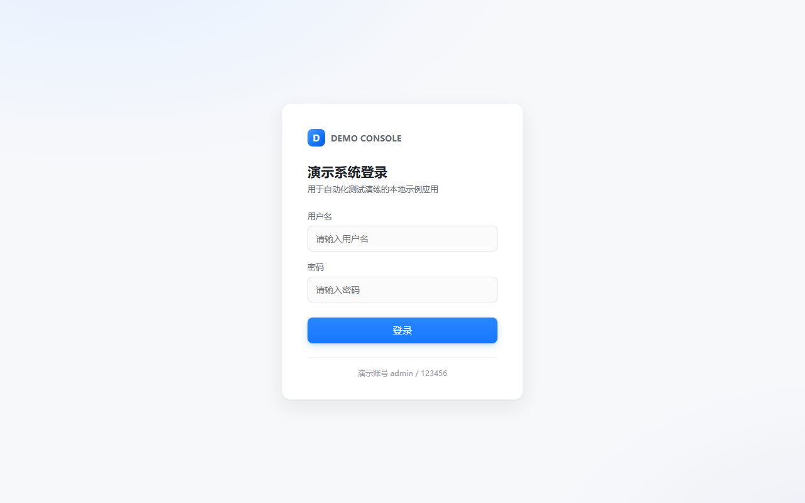
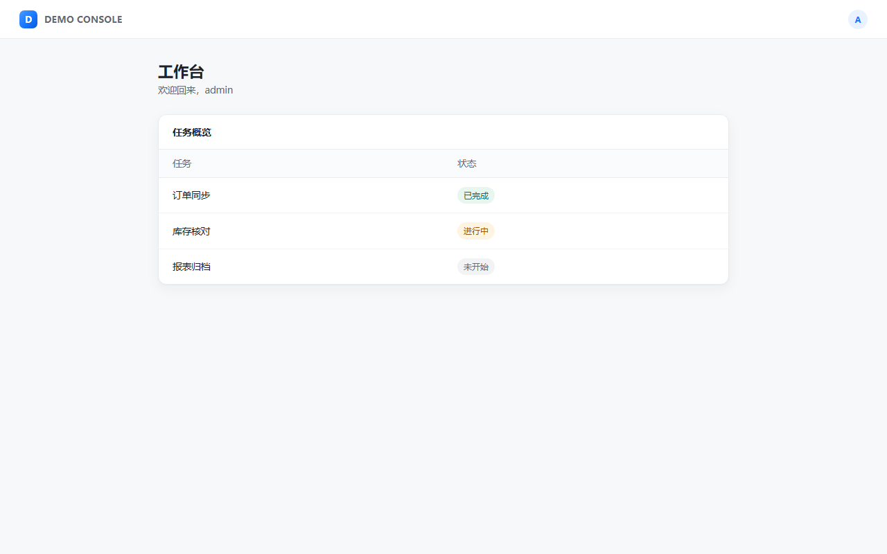

# jben

**浏览器 UI 自动化测试工程脚手架** —— 建工程、改造录制脚本、连跑验收，一条链路闭环。


开箱即可运行：内置 demo 被测应用，`pip install` 之后两条命令就能看到 3 个用例跑绿。

<p align="center">
  
  
</p>

---

## 它解决什么问题

录制脚本能跑，但三个月后没人敢改 —— 大多数 UI 自动化工程死在这几件事上：

| 常见问题 | 本项目的做法 |
|---|---|
| `playwright codegen` 产物直接把选择器写死在流程里，页面一改全挂 | 四档定位策略 + 独立 `locators/` 层，选择器集中维护 |
| 用例层既有业务步骤又有底层 API，换引擎要重写一遍 | PO 分层 + `BrowserSession` 接口，引擎只由环境变量切换 |
| 「本地能过、CI 挂了」，flaky 用例靠重跑掩盖 | 连跑 N 次验收，输出 STABLE / FLAKY / BROKEN 判定，不接受重跑掩盖 |
| 没人知道这批脚本到底稳不稳 | 验收结果导出 Excel，可直接交付给项目方 |

## 核心特性

- **双引擎一套代码**：`BROWSER_ENGINE=playwright|selenium`，PO 与定位两层完全复用
- **A 档定位契约**：只用 `data-testid` / `data-test` / `data-qa`，结构选择器（nth-child、深层 class 链）在体检阶段直接判不通过
- **零硬编码**：地址、账号、引擎、超时全部走环境变量，`.env` 不入库
- **禁止 `sleep`**：统一走 `wait_visible()`，Playwright 与 Selenium 后端都内置元素级等待
- **可迁移的 Python 3.7 语法闸门**：不用 walrus、不用 `list[str]`、不用 `match`，老环境也能跑
- **自带被测算例**：内置 demo 应用（`127.0.0.1:8765`），不依赖任何外部系统即可验证脚手架本身

## 快速开始

```bash
git clone <this-repo> && cd jben/assets/template_project

pip install -r requirements.txt
python -m playwright install chromium   # 仅首次；本机有 Chrome 时会自动复用，可跳过
python start_demo.py                    # 终端 1：启动 demo 应用
pytest -v                               # 终端 2：跑用例
```

期望输出：

```
testcases/test_login.py::TestLogin::test_demo_001 PASSED                 [ 33%]
testcases/test_login.py::TestLogin::test_demo_002 PASSED                 [ 66%]
testcases/test_login.py::TestLogin::test_demo_003 PASSED                 [100%]

============================== 3 passed in 5.11s ==============================
```

切换引擎无需改一行代码：

```bash
BROWSER_ENGINE=selenium pytest -v   # Linux / macOS / Git Bash
```

```bat
:: Windows cmd 分两行写：`set X=Y && ...` 会把尾随空格写进变量值
set BROWSER_ENGINE=selenium
pytest -v
```

> Selenium 引擎依赖本机 Chrome 与匹配的 chromedriver。国内网络下自动下载常失败，
> 可从 [npmmirror chrome-for-testing 镜像](https://registry.npmmirror.com/-/binary/chrome-for-testing/)
> 手动下载对应大版本的 `chromedriver` 放入 `PATH`。

## 已验证结果

模板工程在本机（Windows 11 / Python 3.13 / Chrome 157）的实际运行结果，非设计目标值：

| 检查项 | 命令 | 实际结果 |
|---|---|---|
| Playwright 用例 | `pytest testcases/test_login.py -v` | **3 passed in 5.11s** |
| Selenium 用例 | `BROWSER_ENGINE=selenium pytest -v` | **3 passed**（同一套 PO 与定位，零改动） |
| 连跑验收 | `verify_stability.py --count 3` | **STABLE 3 / FLAKY 0 / BROKEN 0** |
| 定位体检 | `locator_check.py --files locators/login_locators.py` | **A 档 8 / B 0 / C 0 / D 0**，判定通过 |

> Selenium 首次运行耗时明显长于 Playwright —— 那是 Selenium Manager 联网校验驱动的开销，
> 与用例本身无关；驱动就位后恢复秒级。这也是本模板默认引擎选 Playwright 的原因。

## 目录结构

```
jben/
├── SKILL.md                        # AI Agent 入口（可作为 opencode skill 安装）
├── README.md
├── scripts/                        # 工具链，与工程解耦，可独立使用
│   ├── learn_style.py              # 归纳既有工程风格 → style_guide.md
│   ├── locator_check.py            # 定位体检，输出 A/B/C/D 分级
│   ├── verify_stability.py         # 连跑 N 次验收 → MD/JSON 报告
│   └── export_result_excel.py      # 稳定性报告 → Excel
├── references/                     # 规范文档：定位策略 / 风格规范 / 验收规则
└── assets/template_project/        # 已通过验收的工程模板
    ├── conftest.py                 # 函数级浏览器会话夹具
    ├── demo/                       # 内置被测应用（login / dashboard）
    ├── start_demo.py               # 零依赖静态服务器
    ├── testcases/                  # 用例层：只写步骤与断言
    ├── page/                       # PO 层：业务动作，不暴露选择器
    ├── locators/                   # 定位层：A 档常量集中维护
    ├── util/                       # browser.py / env.py / logger.py
    ├── api/ db/ cli/               # 预留分层
    └── reports/                    # 验收产物（xlsx / logs，不入库）
```

## 工具链

```bash
# 1. 定位体检：列出每个选择器的等级，D 级必须清零
python scripts/locator_check.py --files locators/login_locators.py

# 2. 连跑验收：N 次全部 passed 才算通过，退出码 0/1 可直接接 CI
python scripts/verify_stability.py \
    --project . --target testcases/test_login.py --count 3 --report-dir ./.stability

# 3. 导出 Excel：把 JSON 报告转成交付用的表格
python scripts/export_result_excel.py

# 4. 风格归纳：接入既有工程时，先扫一遍再决定怎么写
python scripts/learn_style.py --project <既有工程目录>
```

Windows 下执行脚本前置 `PYTHONUTF8=1`，避免控制台 GBK 解码报错。

## 定位四档

| 档位 | 依据 | 说明 |
|---|---|---|
| **A** | `data-testid` / `data-test` / `data-qa` | 前端契约属性，改版不影响，**首选** |
| **B** | `role` / `label` / `placeholder` / `name` | 语义定位，稳定但有少量歧义风险 |
| **C** | 可见文本 | 文案一改就挂，仅在无可选时使用 |
| **D** | `nth-child` / 绝对 XPath / 深层 class 链 | **禁用**，体检不通过 |

四档不是风格偏好，是维护成本的差异。A 档定位的用例在页面重构后通常无需修改。

## 稳定性验收

连跑 N 次（默认 3），单条用例的判定：

| 判定 | 含义 | 是否通过 |
|---|---|---|
| `STABLE` | N 次全部通过 | 是 |
| `FLAKY` | 时过时不过 | 否，必须修复 |
| `BROKEN` | N 次全部失败 | 否，必须修复 |
| `MISSING` | 根本没被收集到 | 否，检查命名 |

**`FLAKY = 0` 且 `BROKEN = 0` 才允许合入。** 自动修复最多 2 轮，仍不通过则输出根因判断交回人工 —— 不允许靠重跑或降低断言语义来「通过」。

## 硬性规范

1. 用例层、PO 层禁止直接调用 `webdriver` / `playwright` API，必须走 `BrowserSession`
2. 断言用原生 `assert`，消息格式必须是「期望 X / 实际 Y」
3. 配置一律经 `util.env.get_env()` 读取，禁止硬编码 URL、账号、超时
4. 命名：文件 `test_{module}.py`、类 `Test{Module}`、函数 `test_{case_id}`
5. 定位 D 级清零才能进入连跑验收

## 作为 AI Agent Skill 使用

本仓库同时是一个 [opencode](https://opencode.ai) 规范的 skill。装有 opencode 的环境可直接软链：

```bash
git clone <this-repo> ~/.config/opencode/skills/jben
```

之后在对话里说「用 jben 建一个浏览器自动化工程」即可，Agent 会按 `SKILL.md`
的工作流拉模板、改录制脚本、跑验收。`SKILL.md` 里的规范与本文一致，只是面向 Agent 表述。

## 不适用范围

诚实地讲清楚边界，比夸大能力有用：

- **只覆盖浏览器端**：不含 App、桌面端、接口测试（`api/` 为预留分层，暂无实现）
- **不是低代码平台**：用例仍需手写，脚手架省的是结构而不是思考
- **不解决环境问题**：被测系统本身的稳定性、数据准备、登录态管理需要你自行设计
- **模板不是银弹**：接入真实项目时请先跑 `learn_style.py` 对齐既有风格，直接套模板会水土不服

## License

[MIT](LICENSE)
